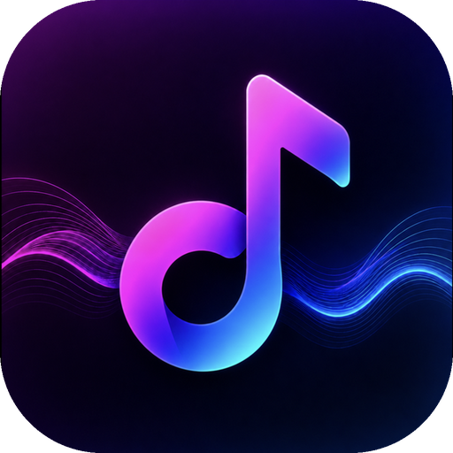
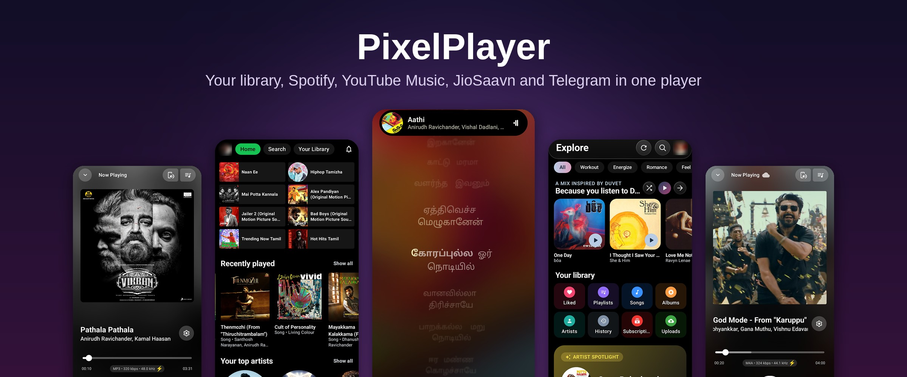
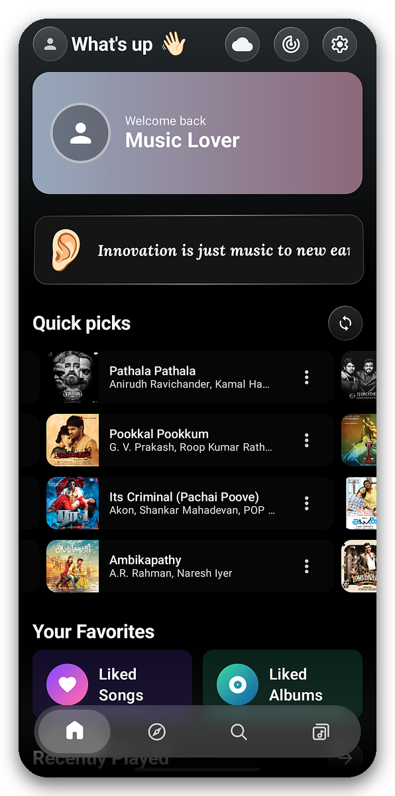
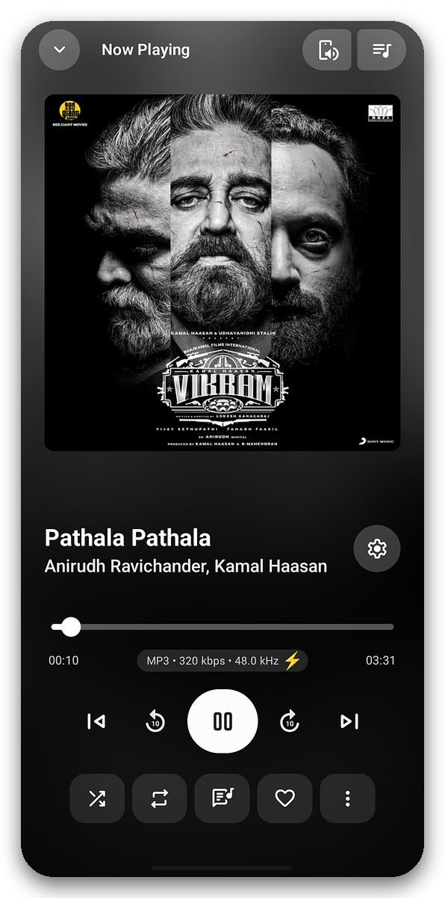
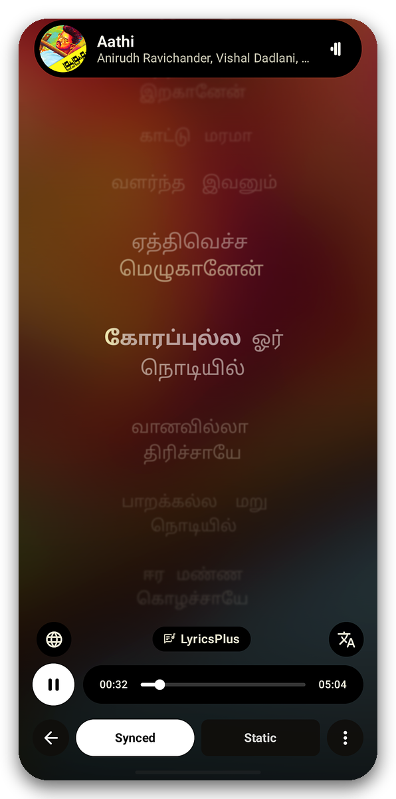
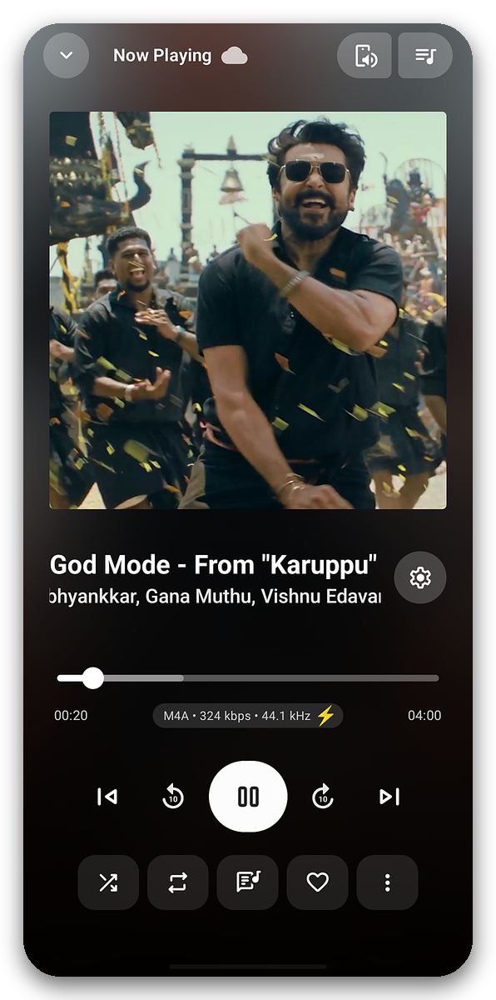
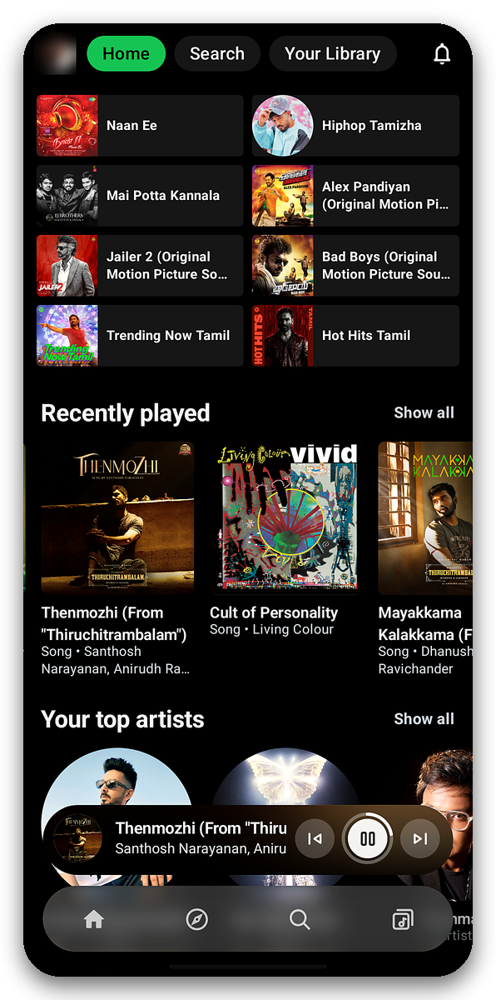
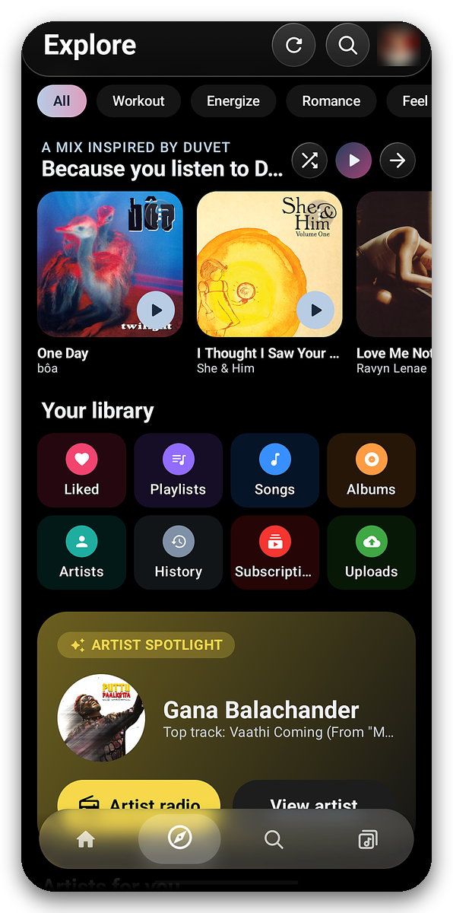
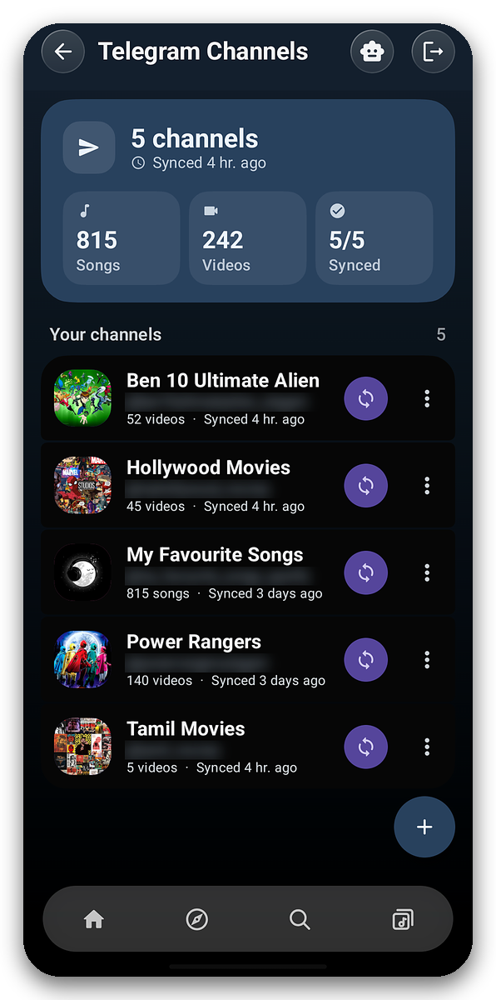
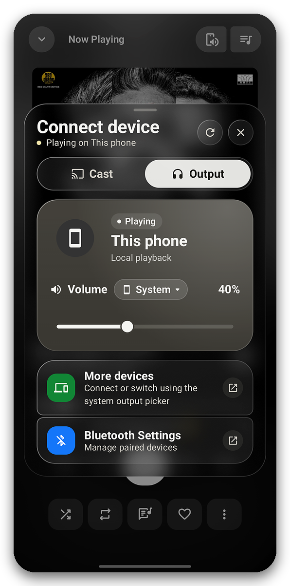

  

<h1 align="center">PixelPlayer</h1>

  <strong>One player for your phone's music, Spotify, YouTube Music, JioSaavn and Telegram.</strong>

  
  

  

This page holds the published builds of PixelPlayer. Each [release](https://github.com/AkashGanes/PixelPlayer-releases/releases) has the APK and what changed in it, and the app's own update check reads them from here.

---

## ⬇️ Install

1. Download **`PixelPlayer-x.y.z.apk`** from the **[latest release](https://github.com/AkashGanes/PixelPlayer-releases/releases/latest)**.
2. Open it on your phone. When Android asks, allow installs from your browser or file manager.
3. That's it. From then on the app checks for new versions once a day and installs them over the old one. Your settings are kept. You can also check yourself in **Settings → About → Check for updates**.

**Needs:** Android 10 or later. 4 GB of RAM or more is recommended.

## 🚀 Getting started

| To use | Do this |
|---|---|
| Your phone's music | Allow access to music when asked. **Settings → Music Management** chooses the folders. |
| Spotify | Tap **☁ on Home → Spotify** and sign in. |
| YouTube Music | Open **Explore**, tap the profile picture and sign in (more than one account works). |
| 320 kbps from JioSaavn | **Settings → Playback → 320 kbps (JioSaavn)**: one switch for playing, one for downloads. |
| Telegram | **☁ on Home → Telegram**, sign in, and add channels with **+**. Bots are behind the robot icon. |
| Your TV | Tap **Connect device** in the player and pick the TV. |
| AI playlists | **Settings → AI Integration**: add a Gemini (or other provider) key, then open the **AI Playlist Lab**. |

---

## Screenshots

| Home | Player | Live lyrics | Canvas |
|:---:|:---:|:---:|:---:|
|  |  |  |  |
| **Spotify** | **Explore (YouTube Music)** | **Telegram channels** | **Connect device** |
|  |  |  |  |

---

## ✨ What it does

**Every source in one place**
- Your phone's music (MP3, FLAC, AAC, OGG, WAV, M4A, Opus and more).
- **Spotify**: your playlists and Liked Songs, Home, Search, What's New, your top artists, full discographies, credits and Canvas, as in the Spotify app.
- **YouTube Music**: Home, moods, charts, podcasts, your library, history and playlists, with several accounts.
- **JioSaavn 320 kbps**: Spotify and YouTube songs play in 320 kbps when JioSaavn has the same recording, never a remix, live version or wrong-language dub.
- **Telegram**: channels in your library, bots you can chat with, and file downloads with pause and resume.
- Also Google Drive, Subsonic servers (Navidrome, Airsonic), NetEase Music and QQ Music.

**The player**
- Switch a YouTube song to its **music video**, in up to the best quality it has.
- **Live words lyrics** that light up as they're sung, from ten sources, with translation.
- **Canvas** videos for Spotify songs, and player themes including AMOLED and Silk.
- An **Equalizer** with surround, bass and voice effects, and your phone's own effects (DeepField, Dolby Atmos) stay on.

**And more**
- **Chromecast** for songs, YouTube videos and Telegram films, with a choice of audio language on the TV.
- **AI playlists** from a sentence ("AR Rahman melodies"), Daily Mix and listening stats.
- **Save my plays to Spotify**, so Spotify's suggestions follow what you play here.
- A **Liquid Glass** navigation bar you can swipe, frosted sheets, Material You colours.
- **Backups** to your Telegram Saved Messages.

What changed in each version: see the **[releases](https://github.com/AkashGanes/PixelPlayer-releases/releases)**.

---

PixelPlayer isn't affiliated with Spotify, YouTube, JioSaavn or Telegram; sign-ins go to each service's own pages. The source code lives in a separate repository.
